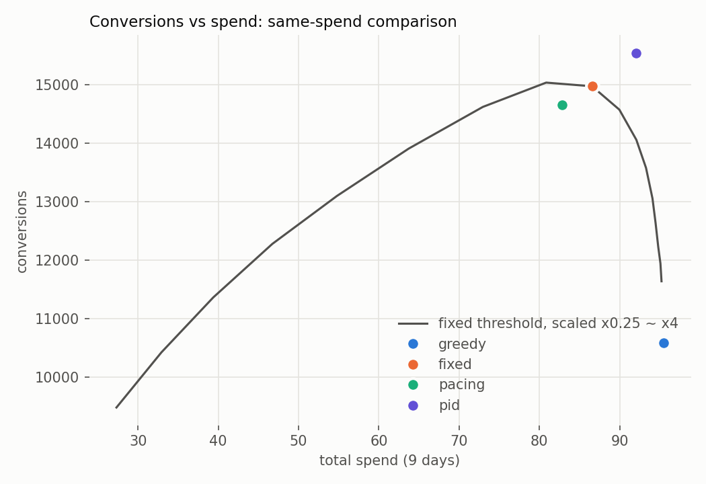
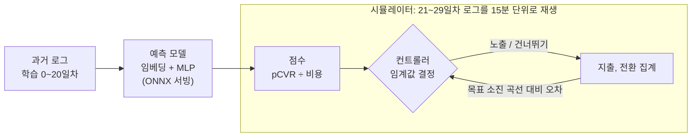

# Throttle

**pCVR 예측 모델을 제어 루프에 연결해 광고 예산 소진을 조절하고, 그 효과를 실제 광고 로그 재생으로 측정한 프로젝트**

Criteo의 실제 광고 로그 31일치를 15분 단위로 다시 재생하면서, 예측 모델과 컨트롤러(고정 임계값, 페이싱, PID)를 연결했을 때 전환, CPA, 예산 소진이 어떻게 달라지는지 비교했습니다.

## 핵심 결과

1. **PID는 같은 지출에서 고정 임계값보다 전환이 10.5% 많습니다** (95% 신뢰구간 +5.8~+15.5%). 소진 편차는 55% 줄었고(7.30 → 3.25%p), 조기 소진은 45%에서 16%로 줄었습니다. 고정 임계값은 값을 어떻게 골라도 PID의 전환 수에 못 미쳤습니다(최선의 고정 대비 +3.4%).
2. **확률이 4.5배 부풀려진 모델을 넣으면 고정 임계값은 CPA가 39%, 페이싱은 34% 나빠집니다** (신뢰구간 +35~+43%, +31~+38%). PID는 반나절 만에 임계값을 스스로 올려 회복했습니다. 다운샘플링 보정식 한 줄이면 모든 컨트롤러가 정상으로 돌아옵니다.
3. **AUC를 올린 모델이 성과는 나아지지 않았습니다.** 사용자 이력 피처로 AUC를 0.836에서 0.841로 올렸지만 고유 전환은 늘지 않았습니다(−0.7%). 라벨을 "전환 직전 마지막 노출"로 바꾸자 AUC는 0.818로 내려갔지만 고유 전환은 4.0% 늘었습니다(신뢰구간 +3.4~+5.0%). 30일 전환 라벨이 같은 사용자의 노출을 반복 구매하도록 만들고 있었습니다.



신뢰구간은 캠페인 단위 블록 부트스트랩(2,000회)으로 구했습니다. 전체 실험(가설, 결과, 예상과 다른 점, 원인 분석, 다음 액션)은 **[실험 리포트](reports/REPORT.md)**에 있습니다.

## 구조



- **예측 모델**: 범주형 임베딩 + MLP. 로지스틱 회귀를 비교 기준으로 함께 학습했고, temperature scaling, isotonic, 다운샘플링 보정식을 비교했습니다.
- **점수**: pCVR만으로 고르면 비싼 노출만 골라 무작위보다 CPA가 나빴습니다(pCVR 상위 20% 노출의 평균 비용이 하위 20%의 12배). 그래서 `pCVR × 목표CPA ≥ 비용`과 같은 pCVR ÷ 비용을 씁니다.
- **컨트롤러**: 고정 임계값, 확률적 페이싱, PID(로그 스케일 임계값, 목표 누적 소진 대비 오차), 그리고 PID 바깥에 하루 1번 전환 지연을 감안해 점수를 다시 보정하는 성과 피드백 루프
- **서빙**: sigmoid와 보정식을 포함해 ONNX로 내보냈습니다. CPU 1스레드, 배치 1 기준 초당 82,000건으로, 하루 3,000만 건(초당 약 350건)의 200배 이상입니다.

## 실험

| # | 질문 | 결과 |
|---|---|---|
| 1 | PID가 고정 임계값보다 나은가? | 같은 지출 기준 전환 +10.5%, 소진 편차 −55% |
| 2 | 확률이 틀리면 제어가 얼마나 망가지나? | 고정 CPA +39%, 페이싱 +34%, PID는 첫날만 +12% 후 회복 |
| 3 | PID 게인에 따라 어떻게 달라지나? | Kp=32까지 발산 없음, 전환은 Kp=16에서 최대, 큰 Ki는 적분 누적으로 조기 소진 증가 |
| 4 | 전환율이 급락하면? | 세 컨트롤러 모두 지출을 줄이지 않아 CPA 2배. 전환이 1일 안에 관측되는 비율은 27% |
| 5 | 모델 AUC를 올리면 성과도 오르나? | AUC↑ 전환 그대로, 라벨을 목표에 맞추자 AUC↓ 전환 +4.0% |
| 6 | 이 차이들이 우연이 아닌가? | 실험 1·2의 주요 차이와 실험 5의 라벨 효과는 95% 신뢰구간이 0을 포함하지 않음 |
| 7 | 급락에 반응하는 컨트롤러를 만들 수 있나? | 지연을 감안한 성과 피드백 + 효율 하한선으로 급락 캠페인 CPA 악화를 oracle 대비 81% 회복, 급락이 없을 때 오작동 없음. 지연을 무시하면 정상 캠페인 전환 −19% |

## 데이터

[Criteo Attribution Modeling for Bidding Dataset](https://huggingface.co/datasets/criteo/criteo-attribution-dataset) (Criteo AI Lab, CC BY-NC-SA 4.0). 31일, 노출 1,647만 건, 캠페인 675개.

- 노출 상위 20개 캠페인에서 사용자 해시로 40%를 남김 → 185만 행
- 날짜 경계로 시간순 분할: 학습 0~17일차, 검증 18~20일차, 시뮬레이션 21~29일차
- 원래 Criteo AI Lab 페이지의 다운로드 링크는 동작하지 않아, Criteo 공식 Hugging Face 계정의 파일을 사용했습니다.

## 실행 방법

Python 3.11

```bash
pip install -r requirements.txt
mkdir -p data/raw && curl -L -o data/raw/criteo_attribution_dataset.tsv.gz https://huggingface.co/datasets/criteo/criteo-attribution-dataset/resolve/main/criteo_attribution_dataset.tsv.gz
python src/prepare_data.py      # 샘플링, 시간순 분할, EDA (~11초)
python src/train.py             # LR, MLP, 다운샘플링 MLP 학습과 캘리브레이션 비교 (~50초)
python src/export_onnx.py       # ONNX 변환, 출력 일치 확인, 추론 속도 측정 (~25초)
python src/simulator.py         # 컨트롤러 동작 확인 (~3초)
python src/train_features.py    # 실험 5: 이력 피처, 라벨 변형 모델 11개 (~2분)
python src/run_experiments.py   # 실험 1~7 (~45초)
```

랜덤 시드를 고정했고, 같은 명령을 다시 실행하면 실험 결과 CSV가 같게 나오는 것을 확인했습니다.

## 폴더 구조

```
throttle/
├── src/
│   ├── prepare_data.py      # 다운로드한 로그 샘플링, 시간순 분할
│   ├── train.py             # pCVR 모델 학습, 캘리브레이션
│   ├── export_onnx.py       # ONNX 변환, 추론 속도 벤치마크
│   ├── simulator.py         # 로그 시간순 재생 시뮬레이터
│   ├── controllers.py       # 고정 임계값, 페이싱, PID, 성과 피드백 PID
│   ├── train_features.py    # 실험 5: 사용자 이력 피처, 라벨 변형
│   └── run_experiments.py   # 실험 1~7 일괄 실행
├── reports/
│   ├── REPORT.md            # 실험 리포트
│   ├── *.csv                # 실험 결과 표
│   └── figures/             # 그래프
├── requirements.txt
└── README.md
```

## 한계

로그에 있는 노출만 건너뛸 수 있는 오프라인 재생이라, 경쟁과 가격 변화는 반영하지 못합니다. 전환은 상관 기반으로 귀속했고, 노출 가격을 결정 시점에 안다고 가정했습니다. 자세한 내용은 [리포트의 한계 절](reports/REPORT.md#한계)에 있습니다.
