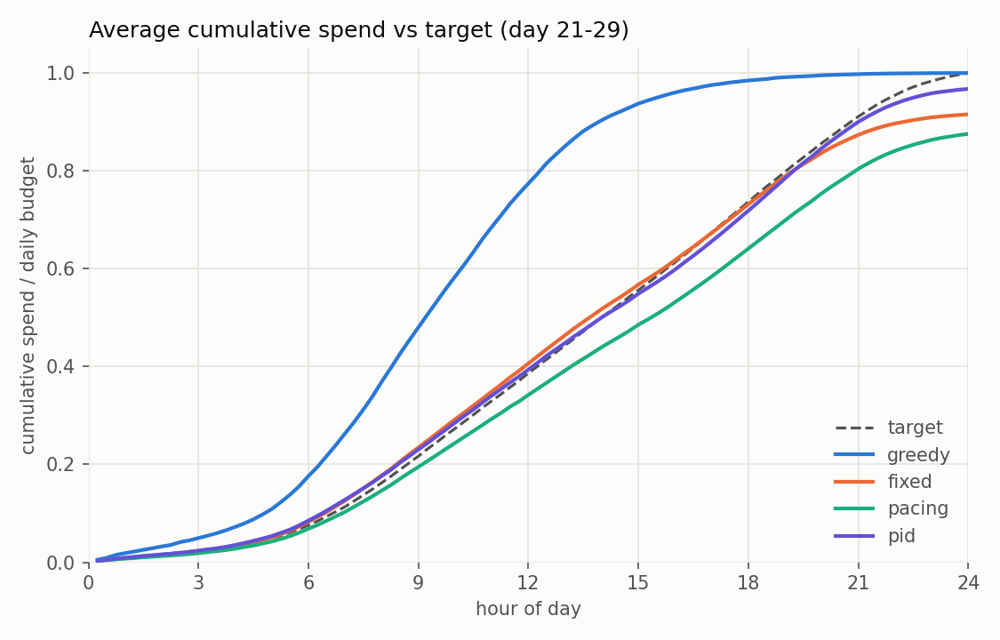
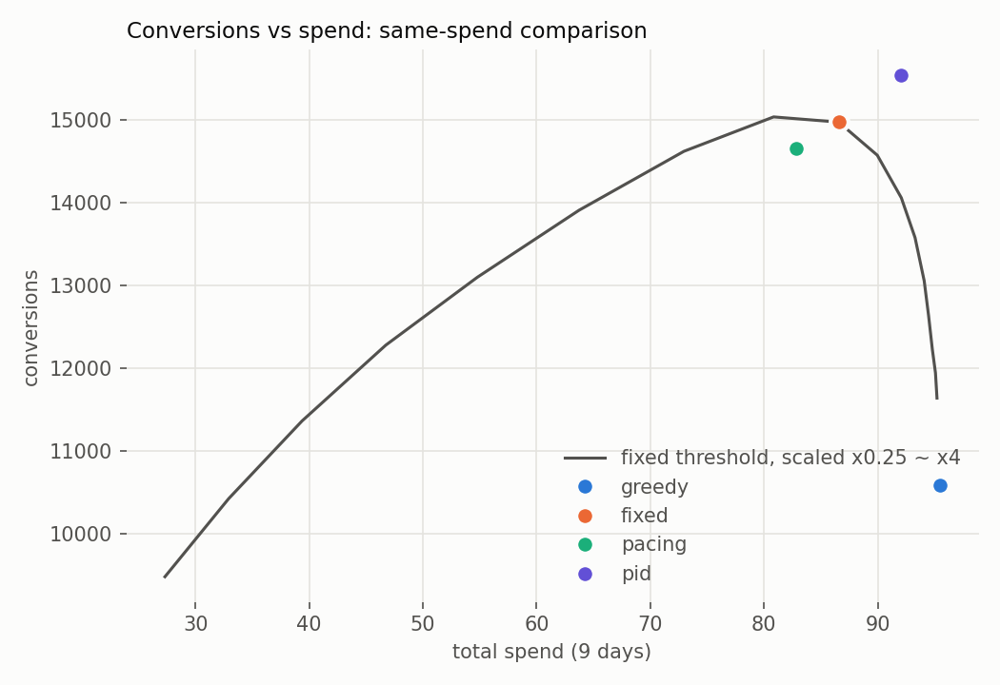
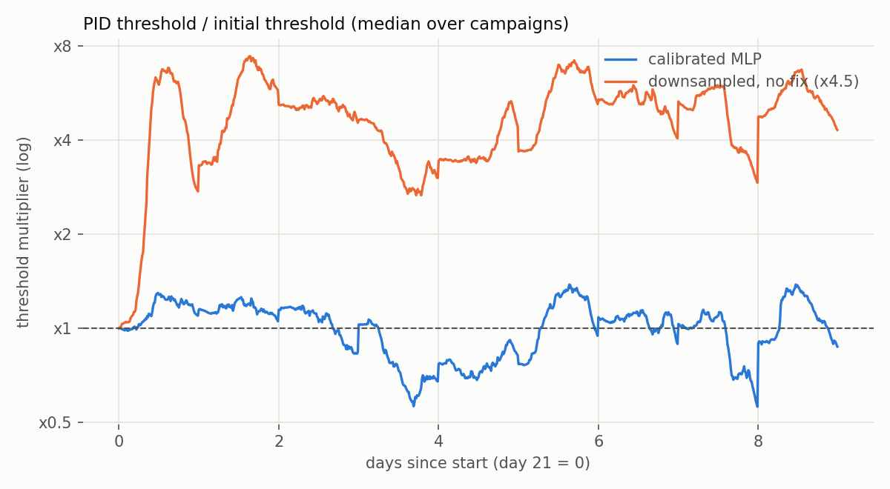
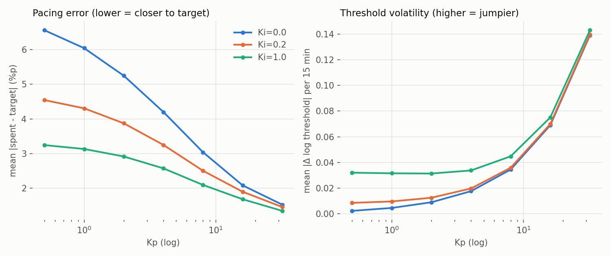
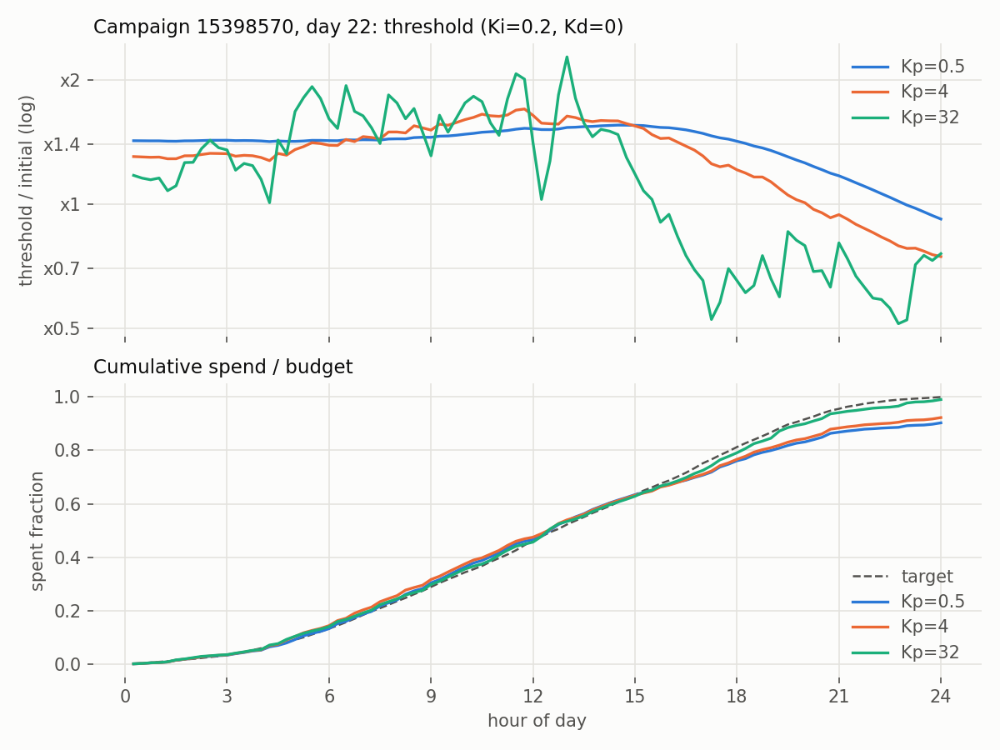
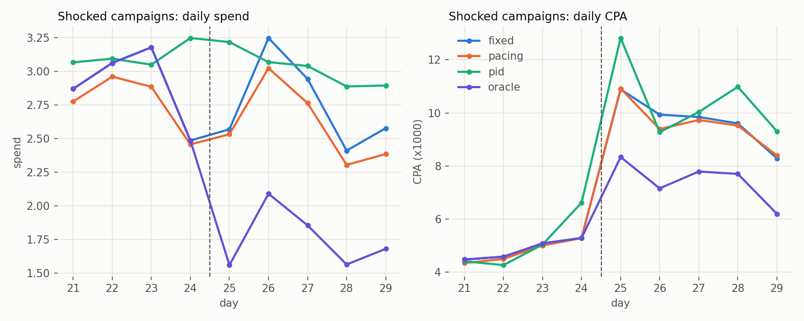
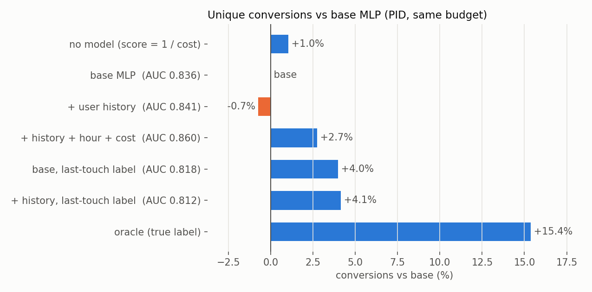
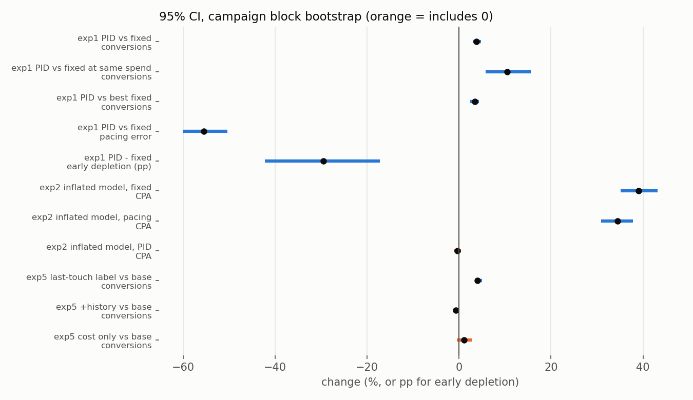

# Throttle 실험 리포트

pCVR 예측 모델을 제어 루프에 연결해 광고 예산 소진을 조절할 때, **어떤 컨트롤러가, 어떤 조건에서, 얼마나** 나은지를 과거 로그 재생 시뮬레이션으로 측정한다.

## 요약

| # | 질문 | 결과 |
|---|---|---|
| 1 | PID가 고정 임계값보다 나은가? | 소진 편차 **−55%** (7.30 → 3.25%p), 조기 소진 45% → 16%, 같은 지출 기준 전환 **+10.5%**. 임계값을 어떻게 골라도 고정 임계값은 PID의 전환 수에 못 미침 (최선의 고정 대비 +3.4%) |
| 2 | 확률이 틀리면 제어가 얼마나 망가지나? | 확률이 4.5배 부풀려진 모델을 끼우면 고정 임계값 CPA **+39%**, 페이싱 **+34%**. PID는 반나절 만에 임계값을 5배 이상 올려 **회복** (첫날 CPA만 +12%). 다운샘플링 보정식 한 줄이면 모든 컨트롤러가 정상 |
| 3 | PID 게인에 따라 어떻게 달라지나? | Kp를 키울수록 소진 편차는 줄고 임계값 변동은 커짐. 예상한 발산은 Kp=32까지 없었음. 전환은 Kp=16에서 최대. Ki를 크게 하면 적분 누적으로 조기 소진 증가 |
| 4 | 전환율이 급락하면? | 세 컨트롤러 모두 **지출을 전혀 줄이지 않아** CPA가 2배가 됨. 컨트롤러가 전환 신호를 입력으로 받지 않는 구조적 한계. 급락을 아는 기준선 대비 CPA +31% |
| 5 | 모델 AUC를 올리면 성과도 오르나? | 사용자 이력 피처로 AUC를 0.836 → 0.841로 올렸지만 **전환은 늘지 않음** (−0.7%). 모델이 같은 전환에 노출을 중복으로 사기 때문. 라벨을 "전환 직전 마지막 노출"로 바꾸자 **AUC는 0.818로 내려갔지만 전환 +4.0%** |
| 6 | 이 차이들이 우연이 아닌가? | 실험 1·2의 주요 차이와 실험 5의 라벨 효과는 캠페인 단위·날짜 단위 블록 부트스트랩 모두에서 95% 신뢰구간이 0을 포함하지 않음. 같은 지출 기준 PID +10.5%의 신뢰구간은 +5.8~+15.5%. "비용만 보기가 기본 MLP보다 낫다"는 우연과 구별되지 않음 |

**예상 밖 발견 두 가지**
1. "pCVR ≥ 임계값"으로 고르면 **무작위보다 CPA가 나쁘다.** pCVR이 높은 노출일수록 비싸기 때문이다. 결정 점수를 **pCVR ÷ 비용**(목표 CPA 입찰 규칙과 동일)으로 바꿔야 모델이 도움이 된다.
2. **AUC를 올리는 것보다 라벨을 목표에 맞추는 것이 성과를 더 올린다.** "30일 안에 전환하는 사용자인가"를 잘 맞히는 모델은 같은 사람에게 노출을 반복해서 산다. 목표인 "고유 전환 수"와 라벨이 어긋나 있었다.

---

## 1. 셋업

### 데이터
- [Criteo Attribution Modeling for Bidding Dataset](https://huggingface.co/datasets/criteo/criteo-attribution-dataset): 실제 광고 로그 31일, 노출 1,647만 건
- 노출 상위 20개 캠페인 × 사용자 해시 40% → **185만 행**
- 시간순 분할: 학습 0~17일차, 검증 18~20일차, 시뮬레이션 **21~29일차** (30일차는 21시까지만 있어 제외)

### 예측 모델 (`src/train.py`, 평가: 21~30일차)
| 모델 | AUC | LogLoss | ECE | 평균 예측 / 실제 |
|---|---|---|---|---|
| 로지스틱 회귀 | 0.8326 | 0.1820 | 0.0020 | 6.07% / 6.17% |
| **임베딩 + MLP** | **0.8360** | **0.1812** | 0.0027 | 6.30% / 6.17% |
| MLP + temperature scaling | 0.8360 | 0.1812 | 0.0043 | 6.59% / 6.17% |
| MLP + isotonic | 0.8358 | 0.1813 | 0.0033 | 6.49% / 6.17% |
| MLP, 음성 10% 다운샘플링 학습 (보정 없음) | 0.8348 | 0.3843 | **0.2168** | **27.85%** / 6.17% |
| 위 모델 + 다운샘플링 보정식 | 0.8348 | 0.1814 | **0.0017** | 6.01% / 6.17% |

다운샘플링 보정식: `p = q / (q + (1 − q) / w)` (w = 0.1). 로짓에 log(w)를 더하는 것과 같다.

### 서빙 (`src/export_onnx.py`)
- sigmoid와 보정식까지 ONNX 그래프에 포함. PyTorch, ONNX, 학습 시 저장한 예측값의 최대 차이 2.4e-7
- CPU 1스레드 기준 ONNX Runtime **82,381건/초 (배치 1)**. 목표치(하루 3,000만 건 ≈ 347건/초)의 237배. 배치 1에서 PyTorch 대비 7.4배, 배치 1024 이상에서는 비슷

### 시뮬레이터 (`src/simulator.py`)
| 항목 | 설정 |
|---|---|
| 재생 | 21~29일차, 15분 구간(하루 96개), 캠페인 20개 × 9일 = 180 캠페인-일 |
| 예산 | 캠페인별 실제 일 평균 비용 × 50% |
| 목표 소진 곡선 | 학습 기간의 캠페인별 15분 구간 비용 비중 누적. 시간대 패턴이 뚜렷함 (새벽 시간당 0.7%, 낮 6%, 날짜 간 상관 0.94) |
| 결정 | 점수 = pCVR ÷ 비용 ≥ 임계값이면 노출, 남은 예산을 넘으면 중단 |
| 기준 임계값 | 검증 기간에 일반 MLP로 "실제 비용의 50%를 보여주게 되는" 점수. 확률 단위로 고정하고 모델만 바꿔 끼움 |
| 전환 집계 | 보여준 노출에 연결된 conversion_id를 캠페인별로 중복 없이 셈 |

### 컨트롤러 (`src/controllers.py`)
| 이름 | 동작 |
|---|---|
| greedy | 임계값 없이 전부 노출, 예산 소진 시 중단 (참고용) |
| fixed | 기준 임계값 고정 |
| pacing | 기준 임계값을 넘는 노출 중 비율 r만 무작위로 노출. r = 다음 구간 계획 소진 ÷ 이번 구간 후보 비용 |
| pid | e = 목표 누적 소진 − 실제 누적 소진, log(임계값) = base − (Kp·e + Ki·Σe + Kd·Δe). 기본 Kp=4, Ki=0.2, Kd=0. 하루 평균 log(임계값)을 다음 날 base로 |

### 지표
| 지표 | 정의 |
|---|---|
| 전환, CPA | 고유 전환 수, 총 지출 ÷ 전환 (×1000으로 표기) |
| 예산 사용 | 총 지출 ÷ 총 예산 |
| 소진 편차 | 15분마다 \|실제 누적 소진 비율 − 목표 누적 소진 비율\|의 평균 (%p) |
| 조기 소진 | 22시 전에 예산 99%를 쓴 캠페인-일 비율 |

---

## 0. 예비 결과: 실험 전에 발견한 것

### 0-1. 보정했더니 오히려 나빠졌다
- **가설**: temperature scaling이나 isotonic 보정은 ECE를 낮춘다.
- **결과**: 평가 구간 ECE가 0.0027에서 0.0043(temperature), 0.0033(isotonic)으로 **나빠졌다.**
- **원인**: 원래 모델이 이미 잘 보정돼 있었다. 그리고 보정기를 학습한 검증 구간의 전환율(6.57%)이 평가 구간(6.17%)보다 높았다. 보정기는 "예측을 올려라"를 배웠고, 평가 구간에서는 그게 틀렸다(기저율 드리프트).
- **다음 액션**: 실험 2를 위해, 실무에서 흔한 음성 다운샘플링으로 **확률이 부풀려진 모델**을 따로 만들었다.

### 0-2. 평균이 맞아도 캠페인별로는 틀린다
전체 평균 예측은 6.30%, 실제는 6.17%로 거의 맞다. 그러나 캠페인별로는 `26852339`를 **2.1배**, `6686701`을 **1.7배** 과대 예측한다. 두 캠페인 모두 시뮬레이션 기간에 전환율이 급락한 캠페인이다(1.8% → 0.8%, 4.8% → 3.0%). → 실험 4

### 0-3. pCVR만 보고 고르면 무작위보다 나쁘다
- **가설**: pCVR이 높은 노출만 보여주면 CPA가 좋아진다.
- **결과**: 각 캠페인 예산(실제 비용의 50%)을 기준별로 채웠을 때의 CPA (×1000)

| 고르는 기준 | 전환ID 중복 제거 | 노출별 라벨 합 | 마지막 노출만 인정 |
|---|---|---|---|
| 무작위 | 8.52 | 5.87 | 10.45 |
| pCVR | **10.34** | 5.45 | **10.93** |
| **pCVR ÷ 비용** | **5.99** | **3.60** | **6.39** |
| 1 ÷ 비용 (싼 것부터) | 5.90 | 3.81 | 6.52 |

  시뮬레이터에서도 "pCVR ≥ 임계값" 규칙의 고정 임계값은 CPA 9.92로 greedy(9.01)보다 나빴다 (`reports/sim_preview.csv`의 `score=p`).
- **원인**: pCVR과 노출 비용의 순위 상관이 0.50이다. pCVR 상위 20% 노출의 평균 비용은 하위 20%의 **12배**다. 로그를 남긴 입찰 시스템이 이미 전환 가능성이 높은 노출에 비싸게 입찰했기 때문으로 보인다. pCVR만 보면 비싼 노출만 골라 같은 예산으로 노출을 훨씬 적게 산다(노출 비율 48% → 18%).
- **변경**: 결정 점수를 **pCVR ÷ 비용**으로 바꿨다. `pCVR × 목표CPA ≥ 비용`과 같은 규칙이다. 여전히 확률의 절대값을 쓰므로 캘리브레이션의 영향은 그대로 남는다.
- **예상과 다른 점 2**: "싼 것부터"(1 ÷ 비용)도 거의 비슷하게 좋다. 이 데이터에서 **모델이 비용 정보 위에 더해주는 이득은 작다.** 전환을 노출별 라벨 합이나 마지막 노출로 세면 pCVR ÷ 비용이 조금 더 낫다.

---

## 실험 1. 컨트롤러 비교

- **가설**: PID는 목표 소진 곡선을 가장 잘 따라가고, 조기 소진을 줄여 같은 예산으로 전환을 더 얻는다.
- **변경 내용**: 일반 MLP, 점수 = pCVR ÷ 비용. 4개 컨트롤러 비교. 공정한 비교를 위해 고정 임계값을 ×0.25~×4로 바꿔가며 (지출, 전환) 곡선을 만들고, 같은 지출에서의 고정 임계값 전환 수와 비교했다.

### 결과 (`exp1_controllers.csv`)
| 컨트롤러 | 전환 | CPA | 예산 사용 | 소진 편차 (평균 / p90) | 조기 소진 | 같은 지출의 fixed 대비 전환 | 최선의 fixed 대비 전환 |
|---|---|---|---|---|---|---|---|
| greedy | 10,590 | 9.01 | 100.0% | 19.00 / 25.17 | 97.8% | −9.0% | −29.6% |
| fixed | 14,976 | 5.78 | 90.7% | 7.30 / 14.83 | 45.0% | 0 | −0.4% |
| pacing | 14,662 | **5.65** | 86.8% | 5.90 / 14.39 | **0.6%** | −2.4% | −2.5% |
| **pid** | **15,548** | 5.92 | **96.4%** | **3.25 / 5.61** | 15.6% | **+10.5%** | **+3.4%** |




- 모델 기반 선택(fixed)은 greedy보다 CPA가 **36% 낮다** (9.01 → 5.78).
- PID는 fixed 대비 소진 편차 **−55%** (p90은 −62%), 조기 소진 45% → 16%, 전환 +3.8%.
- 전환 집계 방식을 바꿔도 결론이 같다. 최선의 fixed 대비 PID의 전환은 중복 제거 +3.4%, 노출별 라벨 합 +4.5%, 마지막 노출만 인정 +4.4%다.

### 예상과 다른 점
1. **고정 임계값의 (지출, 전환) 곡선이 꺾인다.** 임계값을 낮춰 더 쓰게 하면 전환이 오히려 줄었다 (×1.19에서 최대 15,039 → ×0.5에서 13,056).
2. **PID의 CPA는 fixed보다 2.4% 높다** (5.78 → 5.92).

### 원인 분석
1. 고정 임계값을 낮추면 **오전에 덜 좋은 노출로 예산을 다 쓰고** 오후의 좋은 노출을 놓친다(×0.5에서 조기 소진 88%). 그래서 지출을 늘리는 것만으로는 전환이 늘지 않는다. PID는 시간대별로 임계값을 바꿔 같은 지출을 하루에 고르게 배분하므로, 이 곡선 **위에** 있는 유일한 컨트롤러다.
2. PID의 CPA가 높은 건 예산을 더 쓰기 때문이다(한계 효율 하락). 같은 지출로 비교하면 fixed보다 전환이 10.5% 많다.
3. pacing은 조기 소진을 거의 없앴지만, 임계값을 넘는 노출을 **품질과 무관하게 같은 확률로** 버리므로 같은 지출에서 fixed보다 전환이 적다.

### 다음 액션
- 운영 지표를 "CPA 단독"이 아니라 "같은 지출에서의 전환"으로 봐야 한다.
- 남은 개선 여지: pacing처럼 조기 소진을 거의 없애면서 PID의 선별력을 유지하기 → 실험 3의 게인 조정

---

## 실험 2. 캘리브레이션이 제어 성과에 미치는 영향

- **가설**: 확률이 부풀려지면 확률 절대값을 쓰는 임계값 규칙이 망가진다. 피드백이 있는 PID는 일부를 메운다.
- **변경 내용**: 기준 임계값은 일반 MLP로 정한 값 그대로 두고 **모델만** 바꿔 끼웠다. "보정을 빠뜨린 새 모델을 배포한" 상황이다.
  - 다운샘플링 모델 (보정 없음, 확률 평균 4.5배)
  - 다운샘플링 + 보정식
  - 다운샘플링 + isotonic

### 결과 (`exp2_calibration.csv`, CPA ×1000)
| 모델 | fixed CPA | pacing CPA | pid CPA | fixed 조기 소진 | pid 조기 소진 |
|---|---|---|---|---|---|
| 일반 MLP | 5.78 | 5.65 | 5.92 | 45.0% | 15.6% |
| **다운샘플링, 보정 없음** | **8.04 (+39%)** | **7.60 (+34%)** | 5.90 (−0.3%) | **96.7%** | 29.4% |
| 다운샘플링 + 보정식 | 5.68 | 5.58 | 5.92 | 42.8% | 14.4% |
| 다운샘플링 + isotonic | 5.86 | 5.73 | 5.90 | 53.3% | 14.4% |

일별 CPA (`exp2_daily.csv`)

| 일차 | 21 | 22 | 23 | 24 | 25 | 26 | 27 | 28 | 29 |
|---|---|---|---|---|---|---|---|---|---|
| pid, 일반 MLP | 4.14 | 4.07 | 4.45 | 5.11 | 5.15 | 4.34 | 4.30 | 4.46 | 4.27 |
| pid, 보정 없음 | **4.62** | 4.14 | 4.46 | 5.04 | 5.18 | 4.33 | 4.24 | 4.41 | 4.20 |
| fixed, 보정 없음 | 6.57 | 6.20 | 6.27 | 6.15 | 6.34 | 6.16 | 6.45 | 6.22 | 6.26 |



### 예상과 다른 점
1. **pacing도 크게 망가졌다** (CPA +34%). 그런데 소진 편차는 3.45%p로 일반 MLP일 때(5.90)보다 오히려 좋았다.
2. **PID는 거의 완전히 회복했다.** 9일 합계로는 일반 MLP와 차이가 없고, 손해는 첫날(CPA +12%)과 조기 소진 증가(16% → 29%)에 몰려 있다.

### 원인 분석
1. **pacing은 "언제 쓸지"를 고치지만 "무엇을 살지"는 못 고친다.** 부풀려진 확률 때문에 거의 모든 노출이 임계값을 넘어 후보가 되고, pacing은 그 안에서 무작위로 고른다. 지출 속도는 맞지만 선택의 질은 무작위에 가까워진다.
2. **PID는 임계값 자체를 움직인다.** 다운샘플링 모델과 일반 모델의 순위 상관은 0.956이라 순서는 거의 같다. 그래서 확률이 부풀려진 오류는 "임계값을 몇 배 올리면 되는" 문제가 되고, PID는 첫날 반나절 만에 임계값을 5배 이상 올려 이를 학습한다(그래프의 주황선).
3. 보정식은 확률을 정확히 되돌리므로 학습 비용(첫날 손해)도 없다. isotonic은 검증 구간의 기저율 드리프트(0-1)를 함께 배워서 fixed에서 조기 소진이 53%로 더 많았다.

### 다음 액션
- **피드백 제어는 보정 실수를 상당 부분 흡수하지만, 보정식이 더 싸고 확실하다.** 서빙 그래프에 보정을 포함시킨 이유다(`export_onnx.py`).
- PID가 메울 수 있는 건 "순서는 맞고 크기만 틀린" 오류다. 캠페인별로 다르게 틀린 오류(0-2)는 피드백이 메우지 못한다 → 실험 4

---

## 실험 3. PID 게인과 소진 곡선 안정성

- **가설**: Kp를 키우면 반응이 빨라지지만, 너무 크면 임계값이 진동하고 과다 소진과 과소 소진이 반복된다.
- **변경 내용**: Kp ∈ {0.5, 1, 2, 4, 8, 16, 32} × Ki ∈ {0, 0.2, 1} × Kd ∈ {0, 4}, 총 42개 조합. 임계값 변동성은 15분마다 |Δ log 임계값|의 평균으로 측정했다.

### 결과 (`exp3_pid_gains.csv`, Kd = 0)
| Kp | Ki | 소진 편차 (평균 / p90) | 임계값 변동성 | CPA | 예산 사용 | 조기 소진 | 전환 |
|---|---|---|---|---|---|---|---|
| 0.5 | 0 | 6.56 / 14.47 | 0.002 | 5.81 | 91.9% | 43.9% | 15,096 |
| 0.5 | 0.2 | 4.54 / 8.34 | 0.009 | 5.85 | 94.3% | 18.9% | 15,390 |
| 0.5 | 1 | 3.25 / 5.47 | 0.032 | 6.11 | 98.1% | **36.1%** | 15,326 |
| 4 | 0.2 (기본값) | 3.25 / 5.61 | 0.020 | 5.92 | 96.4% | 15.6% | 15,548 |
| 8 | 0.2 | 2.51 / 4.00 | 0.036 | 5.95 | 97.5% | 12.8% | 15,635 |
| **16** | **0.2** | 1.90 / 2.99 | 0.070 | 5.97 | 98.1% | 8.9% | **15,691** |
| 32 | 0.2 | 1.46 / 2.44 | 0.140 | 6.01 | 98.5% | 6.7% | 15,661 |




- Kp를 키울수록 소진 편차가 단조롭게 줄고(6.56 → 1.46%p), 임계값 변동성은 Kp에 거의 비례해 커진다.
- Kd = 4는 모든 조합에서 소진 편차 차이가 0.1%p 미만이었다.

### 예상과 다른 점
1. **Kp = 32까지 발산이나 소진 곡선의 진동이 없었다.** 임계값은 15분마다 크게 흔들렸지만(궤적 그래프의 초록선), 누적 소진은 오히려 목표에 가장 가까웠다.
2. **Ki를 키우면 평균 편차는 줄지만 조기 소진이 늘었다** (Kp = 0.5에서 Ki 0.2 → 1일 때 조기 소진 18.9% → 36.1%).

### 원인 분석
1. 제어 대상이 "누적 소진"이라 흔들림이 적분되며 평균화된다. 또 임계값을 바꾸면 바로 다음 15분 지출에 반영되어 지연이 거의 없다. 지연이 작은 시스템은 높은 게인에서도 잘 발산하지 않는다. 대신 임계값이 흔들리면 **비슷한 노출을 시각에 따라 다르게 판정**하므로, Kp = 32에서 전환이 16보다 줄었다.
2. 새벽에는 목표 증가량이 작아 작은 오차도 누적된다. 적분항이 크면 이 누적을 낮 시간에 한꺼번에 갚으려고 임계값을 과하게 내려 **적분 누적(windup)**이 생긴다.
3. 미분항은 누적 소진 오차의 구간 간 차이, 즉 15분 지출의 노이즈를 보므로 유용한 신호가 거의 없다.

### 다음 액션
- 권장 게인: **Kp = 8~16, Ki = 0.2, Kd = 0**. 기본값(Kp=4) 대비 소진 편차 −23~42%, 조기 소진 15.6% → 8.9~12.8%, 전환 +0.6~0.9%.
- 실제 시스템에서는 임계값이 흔들리면 광고주에게 일관성 문제가 생긴다. 변동성 상한(예: 15분당 ±10%)을 두는 것을 검토할 수 있다.
- 임계값 변화폭 제한, 적분항 클램프 축소 같은 windup 방지책을 비교해볼 수 있다.

---

## 실험 4. 전환율 급락 상황

- **가설**: 컨트롤러는 **지출만 보고 전환은 보지 않으므로**, 전환율이 급락해도 지출을 줄이지 않는다.
- **변경 내용**
  - (a) 실제 드리프트: 시뮬레이션 기간에 모델이 과대 예측한 캠페인에서 컨트롤러가 예산을 얼마나 썼는지 확인
  - (b) 인위적 급락: 예산 상위 3개 캠페인(`15398570`, `15184511`, `6686701`)에서 **25일차부터 전환의 50%를 제거**. 모델 예측은 그대로 둔다. 비교 기준으로 급락을 아는 컨트롤러(oracle)도 넣었다. oracle은 25일차부터 임계값을 2배로 올린다.

### 결과
(a) `exp4_real_drift.csv`: 가장 과대 예측된 두 캠페인의 PID 예산 사용

| 캠페인 | 예측 / 실제 | PID 예산 사용 |
|---|---|---|
| 26852339 | 2.11배 | 96.0% |
| 6686701 | 1.68배 | 94.6% |
| (전체 20개 캠페인) | — | 96.4% |

(b) `exp4_shock.csv`: 급락 캠페인 3개 합계, 25~29일차

| 컨트롤러 | 하루 지출 (급락 없음 → 급락) | CPA ×1000 (급락 없음 → 급락) |
|---|---|---|
| fixed | 2.75 → 2.75 | 4.79 → **9.66** (+101%) |
| pacing | 2.60 → 2.60 | 4.75 → **9.54** (+101%) |
| pid | 3.02 → 3.02 | 5.13 → **10.36** (+102%) |
| oracle | 1.75 (−36%) | **7.35** (fixed 급락 대비 −24%) |



### 예상과 다른 점
가설대로였다. 다만 지출이 "거의 같은" 수준이 아니라 **완전히 같았다.** 세 컨트롤러는 전환 라벨을 전혀 입력으로 받지 않으므로, 이 실험이 보여주는 것은 "반응하지 못한다"가 아니라 **반응하지 못해서 생기는 비용의 크기**다.

### 원인 분석
1. 컨트롤러의 목표는 "예산을 목표 곡선대로 쓰기"이고, 성과(CPA)는 모델의 pCVR을 믿는 것으로 대신한다. 모델이 틀리면 컨트롤러는 그걸 알 방법이 없다.
2. 전환 신호를 피드백으로 쓰는 것도 쉽지 않다. 이 데이터에서 노출 후 **1일 안에 관측되는 전환은 27%**, 3일 안에 42%, 7일 안에 60%뿐이다. 오늘 전환이 적게 보이는 게 급락 때문인지 지연 때문인지 구별하기 어렵다.

### 다음 액션
- **전환 지연을 보정한 성과 피드백 루프**: 일 단위로 "관측된 전환 ÷ 지연 분포로 기대되는 관측 전환"을 캠페인별로 계산하고, 이 비율로 pCVR을 다시 보정한다(온라인 재캘리브레이션). 지출을 맞추는 PID(안쪽 루프)와 성과를 맞추는 보정(바깥쪽 루프)의 2단 구조다.
- 목표가 "예산 소진"이 아니라 "목표 CPA"인 캠페인이라면, 성과가 나쁠 때 예산을 남기는 것이 맞다. 컨트롤러의 목적 함수를 캠페인 유형별로 나눠야 한다.

---

## 실험 5. 모델 개선이 제어 성과로 이어지나

- **가설**: 사용자 이력 피처를 넣으면 AUC가 오르고, 같은 예산에서 전환도 늘어난다.
- **변경 내용** (`src/train_features.py`)
  - 이력 피처 5개를 **각 노출 이전 정보만으로** 만들었다: 이전 노출 수, 같은 캠페인 이전 노출 수, 직전 노출 후 경과 시간, 첫 노출 후 경과 시간, 이전 클릭 수. 첫 노출의 이력이 비어 있는지, 누적값이 줄지 않는지 검사했다.
  - 하나씩, 다 같이, 시간대와 비용까지 추가하며 MLP를 다시 학습했다.
  - 바닥과 천장 기준: 모델 없이 비용만 보기(점수 = 1 ÷ 비용), 정답 라벨을 아는 oracle
  - 확률의 크기가 변형마다 다르므로, 시뮬레이션은 크기에 스스로 맞추는 PID로 비교했다.

### 결과
모델 지표 (`exp5_model_metrics.csv`, 평가 21~30일차)

| 변형 | AUC | LogLoss |
|---|---|---|
| 기본 | 0.8360 | 0.1812 |
| + 이전 노출 수 / 같은 캠페인 이전 노출 수 | 0.8355 / 0.8356 | 0.1806 / 0.1806 |
| + 직전 노출 후 / 첫 노출 후 경과 시간 | 0.8361 / 0.8359 | 0.1812 / 0.1814 |
| + 이전 클릭 수 | 0.8371 | 0.1794 |
| **+ 이력 5개 전부** | **0.8409** | 0.1782 |
| + 이력 + 시간대 | 0.8402 | 0.1787 |
| + 이력 + 시간대 + 비용 | 0.8604 | 0.1709 |

제어 성과 (`exp5_features.csv`, PID, 같은 예산)

| 모델 | AUC | 고유 전환 | 기본 대비 | 전환 1개당 노출 | 노출별 라벨 합 | 마지막 노출만 |
|---|---|---|---|---|---|---|
| 모델 없음 (1 ÷ 비용) | — | 15,709 | +1.0% | 1.53 | −6.1% | −2.1% |
| 기본 MLP | 0.8360 | 15,548 | 0 | 1.65 | 0 | 0 |
| + 이력 | 0.8409 | 15,433 | **−0.7%** | 1.67 | +0.2% | −1.1% |
| + 이력 + 시간대 + 비용 | 0.8604 | 15,974 | +2.7% | 1.63 | +1.3% | +1.4% |
| 기본, **마지막 노출 라벨** | 0.8179 | 16,168 | **+4.0%** | 1.59 | −0.1% | +2.5% |
| + 이력, **마지막 노출 라벨** | 0.8125 | 16,193 | **+4.1%** | 1.57 | −0.7% | +2.9% |
| oracle (천장) | — | 17,939 | +15.4% | 1.78 | +24.2% | +23.4% |



### 예상과 다른 점
1. **이력 피처로 AUC는 올랐는데 고유 전환은 줄었다** (+0.005 → −0.7%).
2. **모델 없이 비용만 본 쪽이 기본 MLP보다 고유 전환이 많았다** (+1.0%). 하지만 노출별 라벨 합으로 세면 비용만 보기가 기본 MLP보다 6.1% 적다. 실험 6에서 이 +1.0%는 신뢰구간에 0을 포함하고 날짜 단위로는 부호가 반대여서, **두 방식은 구별되지 않는다**고 보는 것이 맞다.
3. 피처를 하나씩 넣으면 효과가 거의 없고, 5개를 같이 넣어야 AUC가 올랐다.

### 원인 분석
1. **라벨과 목표가 어긋나 있다.** 라벨 `conversion`은 "이 노출 후 30일 안에 전환했나"라서, 한 사용자가 전환하면 그 전에 본 노출이 모두 1이 된다. 모델이 배우는 것은 **사용자의 전환 성향**이다. 반면 시뮬레이터의 목표는 **고유 전환 수**라서, 같은 사용자의 노출을 여러 개 사도 전환은 하나다.
2. 그래서 모델이 좋아질수록 "전환할 사람"의 노출을 **반복해서** 산다. 전환 1개당 보여준 노출이 비용만 보기 1.53 → 기본 1.65 → 이력 1.67로 늘었다. 이력 피처는 바로 "관심 많은 사용자"를 알아보는 정보라서 이 중복을 키웠다.
3. 라벨을 "전환 직전 마지막 노출만 1"로 바꾸면, 모델은 "이 노출이 전환으로 이어지는 바로 그 노출인가"를 배운다. 원래 라벨로 잰 AUC는 내려가지만 중복이 줄어(1.57) 고유 전환이 늘었다. 라벨을 맞춘 뒤에는 이력 피처가 조금이나마 도움이 됐다(+4.0% → +4.1%).
4. 비용을 피처로 넣으면 AUC가 크게 올랐다(+0.024). 노출 가격에 원래 입찰 시스템의 판단이 담겨 있기 때문이다(0-3). 단, 실제 입찰에서는 경매가 끝나기 전에 가격을 모르는 경우가 많아 그대로 쓰기 어렵다.

### 다음 액션
- **모델 평가 지표를 제어 목표와 맞춘다.** 오프라인 AUC만으로 모델을 고르면 이번처럼 성과가 떨어지는 모델을 고를 수 있다. 후보 모델은 시뮬레이터의 고유 전환으로 함께 평가한다.
- 천장(oracle)까지 아직 11% 남아 있다. 마지막 노출 라벨은 근사일 뿐이므로, 같은 사용자에게 이미 보여준 노출 수를 반영해 점수를 깎는 방법(빈도 제한)이나, 노출의 증분 효과를 직접 추정하는 방법(uplift 모델링)을 비교해볼 수 있다.

---

## 실험 6. 신뢰구간: 차이가 우연이 아닌가

- **가설**: 실험 1, 2, 5의 주요 차이는 캠페인 구성이나 날짜가 달라져도 유지된다.
- **변경 내용**: 시뮬레이션을 다시 돌리지 않고, 결과를 단위별로 다시 뽑는 **블록 부트스트랩**(2,000회)으로 95% 신뢰구간을 구했다.
  - 캠페인 단위(20개): 같은 캠페인의 날들은 서로 독립이 아니므로 캠페인을 통째로 복원 추출한다. 비교하는 두 방식은 같은 표본으로 짝지어 계산한다.
  - 날짜 단위(9일): 확인용. 전환은 그날 안에서만 중복 제거하므로 원래 값이 캠페인 단위와 조금 다르다.

### 결과 (`exp6_bootstrap.csv`)
| 비교 | 추정값 | 95% CI (캠페인 단위) | 95% CI (날짜 단위) |
|---|---|---|---|
| 실험 1. PID vs fixed, 전환 | +3.8% | +3.0 ~ +4.7% | +3.0 ~ +6.6% |
| 실험 1. PID vs 같은 지출의 fixed, 전환 | **+10.5%** | **+5.8 ~ +15.5%** | +6.4 ~ +19.1% |
| 실험 1. PID vs 최선의 fixed, 전환 | +3.4% | +2.4 ~ +4.3% | +2.6 ~ +5.6% |
| 실험 1. PID vs fixed, 소진 편차 | −55.5% | −60.0 ~ −50.4% | −61.8 ~ −47.1% |
| 실험 1. PID − fixed, 조기 소진 (%p) | −29.4 | −42.2 ~ −17.2 | −47.2 ~ −8.9 |
| 실험 2. 부풀려진 모델, fixed CPA | +39.1% | +35.1 ~ +43.2% | +41.2 ~ +46.6% |
| 실험 2. 부풀려진 모델, pacing CPA | +34.4% | +30.9 ~ +37.8% | +37.1 ~ +40.7% |
| 실험 2. 부풀려진 모델, PID CPA | −0.4% | −1.2 ~ +0.4% | −1.0 ~ +4.0% |
| 실험 5. 마지막 노출 라벨 vs 기본, 전환 | **+4.0%** | **+3.4 ~ +5.0%** | +1.5 ~ +2.6% |
| 실험 5. 이력 피처 vs 기본, 전환 | −0.7% | −1.3 ~ −0.1% | −0.5 ~ +0.1% |
| 실험 5. 비용만 보기 vs 기본, 전환 | +1.0% | **−0.4 ~ +2.7%** | **−2.4 ~ −1.3%** |



### 예상과 다른 점
1. **"비용만 보기가 기본 MLP보다 낫다"(실험 5)는 우연과 구별되지 않았다.** 캠페인 단위 신뢰구간이 0을 포함하고, 날짜 단위로는 오히려 −1.9%로 부호가 반대다.
2. 이력 피처의 −0.7%도 날짜 단위로는 0을 포함한다.
3. 같은 지출 기준 PID의 우위(+10.5%)는 확실하지만 범위가 넓다(+5.8 ~ +15.5%).

### 원인 분석
1. 비용만 보기와 기본 MLP의 차이는 "전환을 어떻게 세느냐"에 따라 방향이 바뀌는 작은 차이였다(실험 5에서 노출별 라벨 합으로는 비용만 보기가 6.1% 적었다). 캠페인별로 방향이 엇갈려서, 어떤 캠페인이 뽑히느냐에 따라 부호가 바뀐다.
2. 같은 지출 비교는 fixed 곡선에서 보간한 값과 비교하므로, 캠페인 구성에 따라 곡선의 꺾이는 위치가 달라져 변동이 크다. 표본이 20개 캠페인뿐인 것도 이유다.
3. 반면 실험 2의 CPA 악화와 실험 1의 소진 편차 감소는 거의 모든 캠페인에서 같은 방향이라 신뢰구간이 좁다.

### 다음 액션
- 주장의 강도를 신뢰구간에 맞춘다. 실험 5의 결론은 "비용만 보기가 낫다"가 아니라 **"AUC를 올려도 성과가 늘지 않았고, 비용만 보기와 구별되지 않았다. 라벨을 바꿔야 확실히 나아졌다"**로 쓴다.
- 신뢰구간을 좁히려면 캠페인 수를 늘려야 한다(지금은 상위 20개). 샘플링 비율을 낮추고 캠페인을 늘리는 실험을 고려할 수 있다.

---

## 한계

1. **오프라인 재생**: 로그에는 실제로 낙찰된 노출만 있다. 시뮬레이터는 "건너뛰기"만 할 수 있고 새 노출을 살 수 없다. 노출을 건너뛰어도 경쟁 환경과 가격은 바뀌지 않는다고 가정한다.
2. **전환 귀속**: 전환에 연결된 노출 중 하나라도 보여주면 그 전환을 얻은 것으로 셌다. 노출의 인과 효과(증분)가 아니라 상관을 측정한다. 0-3에서 귀속 방식을 바꿔도 결론의 방향은 같았다.
3. **라벨 누수**: 학습 구간 전환의 35.8%는 학습 기간이 끝난 뒤에 일어났다. 실제 운영에서는 학습 시점에 알 수 없는 라벨이다.
4. **예산 설정**: 예산을 시뮬레이션 기간의 실제 비용으로 정했다. 실제로는 미래의 트래픽 규모를 미리 알 수 없다.
5. **표본**: 상위 20개 캠페인, 9일, 시드 1개. 신뢰구간은 실험 6에서 블록 부트스트랩으로 구했지만, 캠페인이 20개뿐이라 일부 구간은 넓다.
6. **비용 변환**: 비용은 Criteo가 변환한 값이라 절대 금액의 의미는 없고, 상대 비교만 유효하다.
7. **가격을 미리 안다는 가정**: 시뮬레이터는 노출 가격을 결정 시점에 안다고 가정한다(점수 = pCVR ÷ 비용). 실제 2차 가격 경매에서는 입찰가만 정하고 가격은 나중에 정해진다.
8. **이력의 범위**: 샘플이 상위 20개 캠페인만 남긴 데이터라, 사용자 이력도 이 20개 캠페인 안에서의 이력이다.

## 재현

```bash
python src/prepare_data.py      # 샘플링, 분할
python src/train.py             # 모델 학습, 캘리브레이션 (~50초)
python src/export_onnx.py       # ONNX 변환, 속도 측정 (~25초)
python src/train_features.py    # 실험 5용 이력 피처 모델 11개 (~2분)
python src/run_experiments.py   # 실험 1~6 (~40초)
```

같은 명령을 다시 실행하면 실험 결과 CSV와 실험 5의 모델 지표가 같게 나오는 것을 확인했다.
